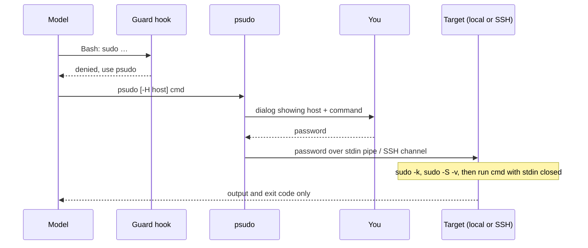

# harness-root-hook

`psudo` runs root commands for **Claude Code** and **Codex** on this computer or
on a host reached over **SSH**. You type your sudo password into a native desktop
dialog that shows the host and the exact command. The password never enters the
model's context, a command line, an environment variable or a plaintext file.

[](LICENSE)


[](https://github.com/MikeRzDev/harness-root-hook/stargazers)

```sh
psudo apt install nginx                       # this computer
psudo -H web1 systemctl restart nginx         # web1 from ~/.ssh/config
psudo -H admin@db.example.com sh -c 'journalctl -u postgres | tail -50'
```

`psudo` is a single static Go binary with no runtime dependencies such as Python or jq.

## Install

### From a release

Download the archive for your platform from
[Releases](https://github.com/MikeRzDev/harness-root-hook/releases), check it
against `SHA256SUMS`, and run the installer for your harness:

```sh
tar -xzf psudo_<version>_<os>_<arch>.tar.gz
cd psudo_<version>_<os>_<arch>
./psudo --install=claude-code     # and/or
./psudo --install=codex
```

The binaries are not signed. If macOS blocks a binary downloaded with a browser,
run `xattr -d com.apple.quarantine psudo` first.

### From source

Requires Go 1.22+.

```sh
git clone https://github.com/MikeRzDev/harness-root-hook.git
cd harness-root-hook
make install-claude-code     # and/or: make install-codex
```

`go install github.com/MikeRzDev/harness-root-hook/cmd/psudo@latest` also works;
then run `psudo --install=…` from `$(go env GOPATH)/bin`.

### Requirements

| | macOS | Linux |
| --- | --- | --- |
| Dialog | built-in `osascript` | `zenity`, `kdialog`, or `ssh-askpass` with a logged-in desktop |
| Password cache | login Keychain (built-in) | `secret-tool` (`libsecret-tools`) and a Secret Service provider such as GNOME Keyring |
| Remote hosts | OpenSSH 8.4+ (built in); key auth, or any login ssh asks for | same |

Restart the harness after installing. Each harness guide covers what the installer does:
[Claude Code](claude-code/README.md) and [Codex](codex/README.md).

## Usage

```
psudo [-H <host>] [--] <command> [args...]
```

- With no `-H`, the command runs on this computer. `<host>` is anything `ssh` accepts, including aliases from `~/.ssh/config`.
- The command is an argument vector, not a shell string: the target receives exactly the same arguments. For pipelines, pass a shell explicitly: `psudo sh -c '…'`.
- stdout and stderr pass through unchanged. The command's stdin is closed.
- psudo accepts no sudo options. Use `psudo runuser -u postgres -- psql` or `sh -c`.

| Exit code | Meaning |
| --- | --- |
| the command's own | The command ran |
| 2 | Usage error (for example an invalid host) |
| 250 | No password dialog available, or the cache settings or credential store are unusable |
| 251 | You cancelled the dialog or it timed out (90 s) |
| 252 | Authentication failed on the target; the command did not run (see the message below) |
| 255 | SSH connection or login failed; no sudo password was requested |

Every failure that psudo itself causes prints one line starting with `psudo:` on stderr.
For exit 252, that line names the cause:

| Message | Meaning |
| --- | --- |
| `psudo: WRONG PASSWORD: …` | sudo rejected the password you typed, or a cached password that is no longer valid (the cache entry is then cleared) |
| `psudo: NOT PERMITTED: …` | the account is not in sudoers, or sudoers does not allow that exact command (checked with `sudo -l` before running) |
| `psudo: AUTHENTICATION FAILED: …` | any other refusal (for example `requiretty`, or a target that keeps no sudo credential and does not allow `/bin/sh`); sudo's own message is shown above it |

A wrong password is never retried automatically, because failures count toward the target's lockout policy.

### Hosts that need more than a key to log in

Some hosts ask for more than a key at SSH login: a one-time code (TOTP), a
password, or a key passphrase. This works the same way for every host, and
nothing needs to be set up per host:

1. psudo first tries your own `~/.ssh/config` with keys only (`BatchMode`).
2. If that fails, psudo logs in itself. Each question ssh asks appears in a
   dialog titled **SSH login**, showing the host and ssh's own prompt (for
   example `Verification code:`). The answer goes straight to ssh through
   `SSH_ASKPASS` and is never stored.
3. psudo keeps that connection for **30 minutes after its last use**. Later
   commands to the same host show only the sudo dialog. `psudo --ssh-logout`
   closes the connections now.

A wrong code or a cancelled SSH login exits 255 before the sudo dialog. If the host
key is unknown, the login is refused. Connect once with `ssh` in a terminal to
accept the key. The kept connection uses a socket in `/tmp/psudo-<uid>/`
(Linux: `$XDG_RUNTIME_DIR/psudo/`), mode 0700. While it is open, any process
running as you can use it. That is the same trade-off as `ControlPersist`
in your own ssh config.

### How it works



On the target, psudo reads the password from stdin and closes stdin for
everything after that. It invalidates sudo's own timestamp, then validates the
password. If the target keeps sudo's timestamp, it runs the exact command with
`sudo -n`. If it does not, the command is authenticated inline and runs through
`/bin/sh` only to keep stdin closed. That fallback needs sudoers to allow
`/bin/sh` there, which psudo checks before anything runs. The password can never
flow into the command. The full design is in [docs/psudo.md](docs/psudo.md).

## Password caching

Local commands reuse a verified password for **two hours** by default. It is
stored only in macOS Keychain or the Linux Secret Service, and the window never
slides. **Remote hosts always prompt** and are never cached. Set `ttl_seconds` to
`0` for a dialog on every command. See [password caching](CACHE.md).

## Uninstall

```sh
~/.claude/hooks/psudo --uninstall=claude-code
"${CODEX_HOME:-$HOME/.codex}/root-hook/psudo" --uninstall=codex
```

## Development

```sh
make test       # go vet + unit tests (fake sudo/ssh/dialogs; no real password or root)
make build      # bin/psudo
make dist       # cross-compiled archives + SHA256SUMS in dist/
make release VERSION=v1.2.3   # gh release create from dist/; run deliberately, no CI
```

The tests run the local and remote transports through the same suite. They check
that the password never shows up in output, argv or environment, and that every
exit code and hook decision matches the spec. Desktop dialogs and real sudo
still need a manual smoke test (see the harness guides).

## Limitations

- Commands that need a terminal or their own stdin (for example a tool that reads a secret with the echo off) cannot run through psudo. Run those yourself in a terminal.
- The remote login shell must be POSIX-compatible. Targets that set `requiretty` are unsupported. Targets that keep no sudo timestamp must allow `/bin/sh` in sudoers.
- Scripts that call `sudo` internally work only when the whole script is the psudo command.
- The Claude Code guard can deny harmless commands that contain the word `sudo` (for example `grep x /var/log/sudo.log`).
- psudo keeps the password away from the model. It does not defend against a hostile process running as your user.

## License

[MIT](LICENSE).
